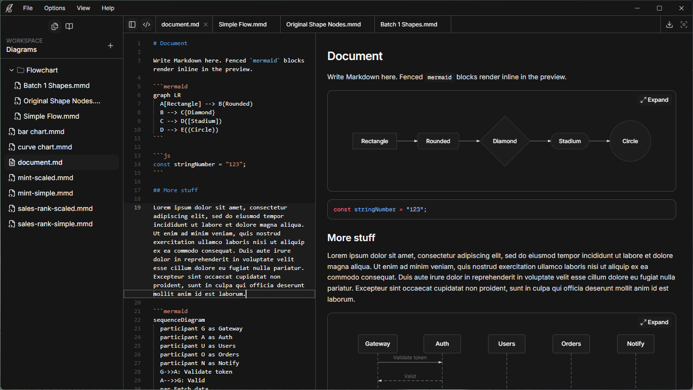

# Scrivon

[](https://github.com/Jamie-Fairweather/scrivon/releases/latest)
[](https://github.com/Jamie-Fairweather/scrivon/actions/workflows/ci.yml)
[](https://codecov.io/gh/Jamie-Fairweather/scrivon/tree/dev)
[](LICENSE)
[](https://github.com/Jamie-Fairweather/scrivon/releases/latest)

**Mermaid & markdown on your machine.**

Scrivon is a desktop editor for [Mermaid](https://mermaid.js.org/) diagrams and Markdown documents. Open a folder on disk, edit `.md`, `.markdown`, `.mmd` or `.mermaid` files with syntax highlighting, and preview diagrams or rendered Markdown live — no account, no cloud workspace required.

<p align="center">
  
</p>

## Features

### Workspaces & files

- **Folder workspaces** — Open any directory on disk; your files never leave your machine
- **File explorer** — Create, rename, duplicate, and delete `.md`, `.markdown`, `.mmd`, `.mermaid` files and folders from the sidebar
- **Links follow moved files** — After you rename or move a file or folder (F2, drag and drop, **Move to…** or **Move Active File to…**), Scrivon lists the Markdown links and images it breaks, in other files and in a moved file's own relative links, with each old and new address, and **Update Links** fixes them. `#fragments`, titles and `/` links are kept, and links in code are never touched. Open tabs change as one **Ctrl+Z** step; other files are saved in their own encoding, and a file that changed meanwhile is skipped. Turn it off in **Settings → General**
- **New from template** — **File → New from Template…**, the explorer's New menus or the command palette start a file from a template: meeting notes, a decision record, a project brief or a titled process flowchart. Add your own by putting `.md`, `.markdown`, `.mmd` or `.mermaid` files in a `.scrivon/templates` folder at the top of the open folder, so they travel with it (in git, say). `{{title}}` (from the new file's name), `{{date}}` and `{{time}}` are filled in
- **Git changes** — In a git repository, the explorer marks the files you have changed since the last commit (**M** modified, **A** added, **U** untracked, **R** renamed, **C** conflicted), and puts a dot on folders with changes inside. It uses your own Git for Windows, only reads the repository, and can be turned off in **Settings → General**
- **Multi-tab editing** — Work across several documents in one session; tab state is restored per workspace. Drag a tab to reorder it, or move the active tab with **Ctrl+Shift+PageUp** / **Ctrl+Shift+PageDown**, and the order is kept for the folder
- **Recent folders** — Quick access from the welcome screen and **File → Open Recent**
- **File history** — Each save keeps a copy of that version in Scrivon's own data folder, never next to your document (up to 50 versions per file, for 30 days). **File → Show File History…** (also in the F1 palette and the tab's right-click menu) compares a version with the text in the editor and puts it back as one change that **Ctrl+Z** undoes. Turn it off, or delete it all, in **Settings → General**
- **Open from File Explorer** — Double-click a `.md`, `.markdown`, `.mmd` or `.mermaid` file, or use **Open with**, to open it in a tab with its folder. If Scrivon is already open, that window opens it. Paths given on the command line work the same way, and so does dropping a file onto the window when no folder is open

### Mermaid diagrams

- **Dedicated diagram files** — Edit standalone `.mmd` / `.mermaid` sources with a split editor and canvas preview
- **Supported diagram types** — Flowcharts (`flowchart` / `graph`), sequence diagrams, class diagrams, state diagrams, entity relationship diagrams and XY charts, drawn by beautiful-mermaid. Pie charts, Gantt charts, mind maps, timelines, user journeys, git graphs, quadrant charts, requirement diagrams, C4 diagrams, Sankey diagrams, block diagrams, packet diagrams, kanban boards, architecture diagrams (built-in icons only), radar charts and treemaps are drawn by the official Mermaid package, in the same diagram theme and offline. Each one is drawn on the canvas, in Markdown, and in every export. A diagram's own `%%{init}%%` or front matter can't change the theme or turn off strict security. ZenUML isn't supported yet. A diagram drawn with HTML labels can be saved as SVG, PDF or HTML, but not as PNG or in Word
- **Mermaid highlighting and starters** — Keywords, arrows, node labels and `%%` comments are coloured in diagram files and in `mermaid` blocks in Markdown. Press **Ctrl+Space** in a diagram file for a starter for flowcharts, sequence, class, state and ER diagrams and XY charts
- **Diagram starters gallery** — **File → New Diagram from Starter…** shows the same starters as cards with a preview of each in your theme, and makes a new `.mmd` file from the one you pick. **Edit → Insert Diagram Starter…** puts the starter in the open file instead: an empty diagram file, or a ` ```mermaid ` block by the cursor in a Markdown file, with Tab moving through its placeholders and Ctrl+Z taking it out again
- **Canvas tools** — Pan and zoom the preview, fit diagram to screen, or switch to preview-only layout
- **Jump from a diagram to its text** — Double-click a node, link or subgraph of a flowchart, a state or transition, or a sequence participant or message, on the canvas or on an expanded Markdown diagram, and the editor selects the text that defines it. The pointer changes and an outline shows what you are about to pick. In the F1 palette, `@` in a diagram file lists its parts to pick from the keyboard. Turn the double-click off with **Double-click the preview to jump to the editor** in **Settings → Editor**
- **Diagram export** — Save the active diagram as SVG or PNG (1×, 2×, or 4×), or copy it to the clipboard. Pick a light or dark diagram theme and a transparent background in the export menu
- **Export every diagram in a folder** — **File → Export → All Diagrams in Folder…**, the command palette, or **Export Diagrams…** on a folder in the explorer saves every `.mmd` and `.mermaid` file as SVG or PNG into a folder you choose, keeping the subfolders if you like. Files already there are never replaced: you choose Keep Both or Skip, and a summary lists what was saved, skipped and failed

### Markdown documents

- **Live Markdown preview** — [GFM](https://github.github.com/gfm/)-style rendering beside the editor (tables, task lists, strikethrough, and more)
- **Syntax-highlighted code** — Fenced code blocks use [Shiki](https://shiki.style/) themes that follow your UI light/dark mode
- **Embedded Mermaid** — `mermaid` fenced blocks render inline; expand any block to the full canvas for pan, zoom, and export
- **Wiki links** — Link notes by name: `[[Note]]` leads to `Note.md` anywhere in the open folder (ignoring case), `[[Note|shown text]]` shows other text, `[[Note#Heading]]` opens the note at that heading, `[[folder/Note]]` names it by path, and `[[#Heading]]` jumps within the file. When two notes share a name, the one in the same folder wins. In the preview they are ordinary links that open the note in its tab; one to a note the folder doesn't have has a dashed underline and says so. Typing `[[` offers the folder's notes, and `[[#` the file's headings (**Tab** picks one). In PDF, Word and HTML a wiki link prints as its words, and `[[#Heading]]` stays a link to the heading
- **Linked from** — Below the headings, the **Outline** panel lists the other notes that wiki-link to the file you're in, with each link's line. Choose one to open it at the link. It follows unsaved edits in open tabs and changes on disk
- **Broken link check** — Links, images, reference definitions and `#heading` links that lead nowhere in the open folder get a warning underline that says what is wrong ("No file called docs/setup.md in this folder"). **F8** goes to the next one, and **Ctrl+.** offers the closest files, folders or headings, replacing only the path or `#fragment` as one step you can undo. A `[[wiki link]]` to a note the folder doesn't have is underlined too. Web, `mailto:` and `tel:` links are never checked. Turn it off in **Settings → Editor**
- **Table helpers** — **Edit → Table → Insert Table…** adds a tidy GFM table of the size you choose. With the caret in a table, insert, delete and move rows and columns, set a column's alignment (left, centre, right or none), and **Format Table** (**Shift+Alt+F**) lines the pipes up, counting Chinese, Japanese and Korean characters and emoji as double width. Every command is one **Ctrl+Z** step and never loses text. Also in the F1 palette, and Insert Table and Format Table can be rebound in **Settings → Keyboard**
- **Present as slides** — **View → Present** (or **F5**) shows the open document full screen, one slide at a time, with a new slide at each top-level `---`. Move with the arrow keys, Page Up/Down, Space, Home and End, and leave with **Esc**. The slides follow your edits as you make them
- **PDF, Word and HTML export** — Save the rendered document as PDF (native export on Windows via WebView2), Word (.docx) or a standalone HTML page, styled by named export profiles (page size, margins, fonts, brand colour, title page, table of contents, header/footer, watermark) in **Settings → Document export**. In Word, math (`$…$`, `$$` blocks and ` ```math ` blocks) comes out as Word equations you can click into and edit, and any math Word can't hold keeps its TeX source. Export from **File → Export**, the command palette, or **Ctrl/Cmd+Shift+X**

### General

- **Built-in examples** — Curated sample diagrams and a Markdown syntax showcase to explore features
- **Themes** — Light and dark UI plus 15+ diagram palettes (Scrivon, Zinc, Tokyo Night, Catppuccin, Nord, Dracula, GitHub, Solarized, One Dark, and more)
- **Autosave** — Optional autosave to disk; **Ctrl/Cmd+S** saves immediately
- **Settings** — **Ctrl/Cmd+,** opens preferences for theme, autosave, editor, and configurable keyboard shortcuts
- **Focus mode** — **View → Focus Mode** (or **F11**) hides the explorer, Outline, tabs, preview and status bar so only the editor shows, filling the window. **Esc** or **F11** leaves it and brings back the panes you had. **Dim other paragraphs** (in **View**, the palette and **Settings → Editor**) fades every line but the paragraph you are writing in, with or without focus mode
- **Command palette** — **F1** to search files, open tabs, run commands, and find text across the workspace. Type `:` to go to a line, `@` to jump to a heading (or a part of a diagram), or `?` to see these
- **Find in Workspace** — **Ctrl/Cmd+Shift+F** searches the text of every file, with Match Case (**Alt+C**), Match Whole Word (**Alt+W**) and Use Regular Expression (**Alt+R**; **Cmd+Option** on macOS). The options are remembered, and a regular expression that runs too long is stopped instead of freezing the window
- **Replace in Workspace** — **Ctrl/Cmd+Shift+H** adds a Replace box to Find in Workspace and previews each change, grouped by file. Replace one match (**Ctrl/Cmd+Shift+1**) or every match in a file as an unsaved edit you can undo, or Replace All (**Ctrl/Cmd+Alt+Enter**) after confirming the true totals. In regex mode, `$1`, `$<name>` and `$&` fill in what was matched. Files keep their encoding and line endings, and a file changed elsewhere in the meantime is skipped
- **Desktop-native** — Built with [Tauri 2](https://v2.tauri.app/) for a fast, local-first experience on Windows
- **Auto-updates** — Updates install in-app; **Help → Check for Updates…** looks for one at any time (see [releases](https://github.com/Jamie-Fairweather/scrivon/releases))

> Scrivon is an independent editor. It is not affiliated with Mermaid Chart Inc. or the mermaid-js project.

## Download

Pre-built installers are published on **[GitHub Releases](https://github.com/Jamie-Fairweather/scrivon/releases)**.

| Channel     | Branch | Notes                                                |
| ----------- | ------ | ---------------------------------------------------- |
| Stable      | `main` | Recommended for everyday use; in-app updates enabled |
| Pre-release | `rc`   | Test builds; update in-app to the next rc or stable  |

**Requirements:** Windows 10 version 1809 (build 17763) or later, or Windows 11, on an x64 or ARM64 PC. The installer stops on older versions of Windows.

## Getting started

### Use a release

1. Download the installer from the [latest release](https://github.com/Jamie-Fairweather/scrivon/releases/latest): `Scrivon_<version>_x64-setup.exe` for most PCs, or `Scrivon_<version>_arm64-setup.exe` for Windows on ARM PCs (such as Snapdragon laptops). It installs Scrivon for your Windows user only, so it needs no admin rights.
    - Already using the x64 version on an ARM PC? Run the ARM64 installer over it. Your settings and recent folders stay.
    - The installers aren't code-signed yet, so Windows may show **Windows protected your PC** the first time. Click **More info**, then **Run anyway**. On PCs with Smart App Control turned on, Windows may block the installer completely.
    - Scrivon needs the Microsoft Edge WebView2 Runtime. Windows 11 and up-to-date Windows 10 already have it. If it's missing, the installer adds it, which needs an internet connection. On a PC without internet access, or on Windows 10 LTSC or Windows Server, install the [WebView2 Runtime](https://developer.microsoft.com/microsoft-edge/webview2/) ("Evergreen Standalone Installer") first.
2. Launch Scrivon and choose **Open Folder**.
3. Select a folder containing `.md`, `.markdown`, `.mmd` or `.mermaid` files.
4. Edit in the center pane; the preview updates as you type.
    - **Diagram files** — Preview renders on the canvas.
    - **Markdown files** — Preview shows rendered Markdown; use **Expand** on a `mermaid` block to open it on the canvas.

### Where Scrivon keeps its data

Your documents stay where you save them. Scrivon keeps its own data in your Windows user folders:

| What                                                                   | Where                                                                                                                          |
| ---------------------------------------------------------------------- | ------------------------------------------------------------------------------------------------------------------------------ |
| The program                                                            | `%LOCALAPPDATA%\Scrivon`, unless you chose another folder when installing                                                      |
| Recent folders, open tabs, window size, and unsaved edits kept for you | `%APPDATA%\io.github.jamie-fairweather.scrivon`                                                                                |
| Settings (theme, shortcuts, export profiles)                           | `%LOCALAPPDATA%\io.github.jamie-fairweather.scrivon\EBWebView`, with a copy in `settings.json` in the `%APPDATA%` folder above |
| Log (`scrivon.log`) and crash log                                      | `%LOCALAPPDATA%\io.github.jamie-fairweather.scrivon\logs`                                                                      |
| File history (earlier saved versions of your files)                    | `%LOCALAPPDATA%\io.github.jamie-fairweather.scrivon\history`                                                                   |
| Data from before version 1.4.1                                         | `com.diagram.app` in `%APPDATA%` and `%LOCALAPPDATA%` (copied across once, then left)                                          |
| Downloaded updates                                                     | `%TEMP%\Scrivon-<version>-updater-…`, removed the next time Scrivon starts                                                     |

To uninstall, open Windows **Settings → Apps**, find Scrivon and choose **Uninstall**. Tick **Delete the application data** to also remove your recent folders, settings, file history and logs, and the old `com.diagram.app` folders. Your documents are never touched.

### Build from source

**Prerequisites:** [Bun](https://bun.sh/), [Rust](https://www.rust-lang.org/tools/install), and platform dependencies for [Tauri](https://v2.tauri.app/start/prerequisites/).

```bash
git clone https://github.com/Jamie-Fairweather/scrivon.git
cd scrivon
bun install
bun run tauri dev
```

For release builds, signing keys, branch workflow, and semantic-release setup, see **[docs/development.md](docs/development.md)**.

## Tech stack

| Layer              | Technologies                                                                                                               |
| ------------------ | -------------------------------------------------------------------------------------------------------------------------- |
| Desktop shell      | [Tauri 2](https://v2.tauri.app/) (Rust)                                                                                    |
| UI                 | [Next.js](https://nextjs.org/), [React 19](https://react.dev/)                                                             |
| Editor             | [Monaco](https://microsoft.github.io/monaco-editor/)                                                                       |
| Diagram rendering  | [beautiful-mermaid](https://github.com/lukilabs/beautiful-mermaid), [Mermaid](https://mermaid.js.org/) for the other types |
| Markdown rendering | [react-markdown](https://github.com/remarkjs/react-markdown), [remark-gfm](https://github.com/remarkjs/remark-gfm)         |
| Code highlighting  | [Shiki](https://shiki.style/)                                                                                              |
| Styling            | [Tailwind CSS](https://tailwindcss.com/)                                                                                   |

## Project layout

```
scrivon/
├── app/                      # Next.js app routes
├── components/studio/        # Editor, canvas, workspace UI
│   └── markdown/             # Markdown preview and embedded diagrams
├── lib/
│   ├── markdown/             # GFM pipeline, Shiki, PDF export HTML
│   └── mermaid/              # Diagram render and export
├── src-tauri/                # Tauri / Rust backend
├── scripts/                  # Build and codegen utilities
└── docs/                     # Maintainer documentation
```

## Contributing

Contributions are welcome. Please open an issue to discuss larger changes before submitting a pull request.

1. Fork the repository and create a branch from `dev`.
2. Use [Conventional Commits](https://www.conventionalcommits.org/) (`feat:`, `fix:`, etc.) so releases can be automated.
3. Run `bun run tauri dev` locally to verify desktop behavior.
4. Open a pull request against `dev` with a clear description of the change. `main` and `rc` only take releases.

See **[docs/development.md](docs/development.md)** for the full release pipeline, branch model, and updater signing.

## Acknowledgments

- [Mermaid](https://mermaid.js.org/) for the diagram syntax
- Example diagrams adapted from [Craft Mermaid samples](https://agents.craft.do/mermaid)
- UI built with [coss](https://coss.com/ui) / Base UI primitives

## License

Scrivon is released under the [MIT License](LICENSE). Third-party dependencies are listed in-app under **Help → Licences**.

## Links

- [Releases](https://github.com/Jamie-Fairweather/scrivon/releases)
- [Development & releases guide](docs/development.md)
- [Report an issue](https://github.com/Jamie-Fairweather/scrivon/issues), or use **Help → Report an Issue** in the app, which fills in your app, Windows and WebView2 versions. **Help → Open Logs Folder** shows the log files to attach. They can show file and folder names, so check them first.
